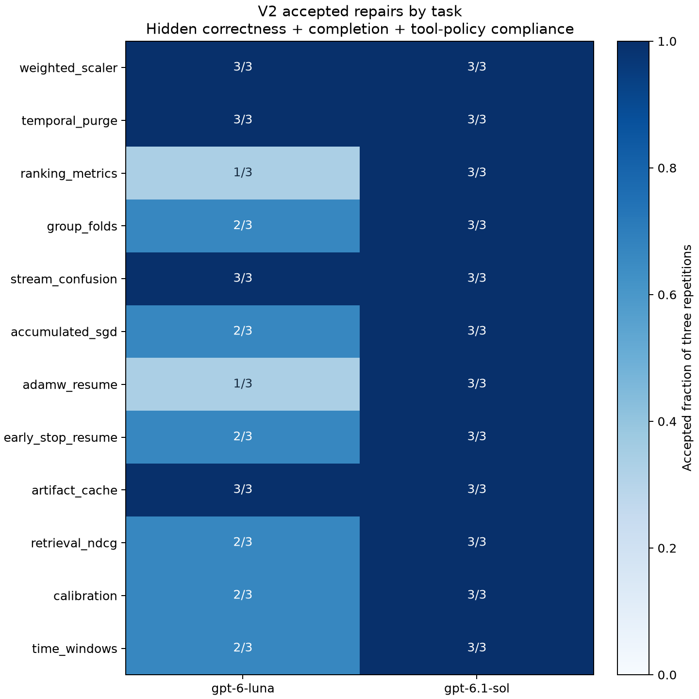
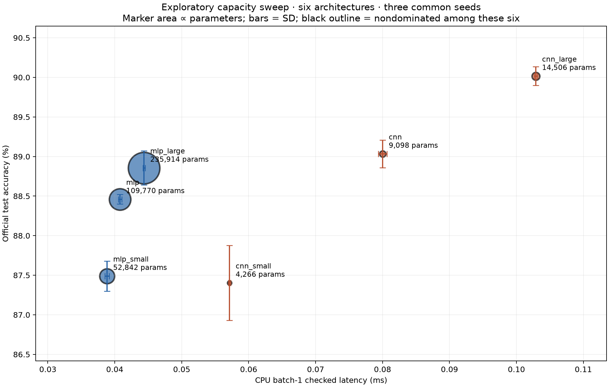
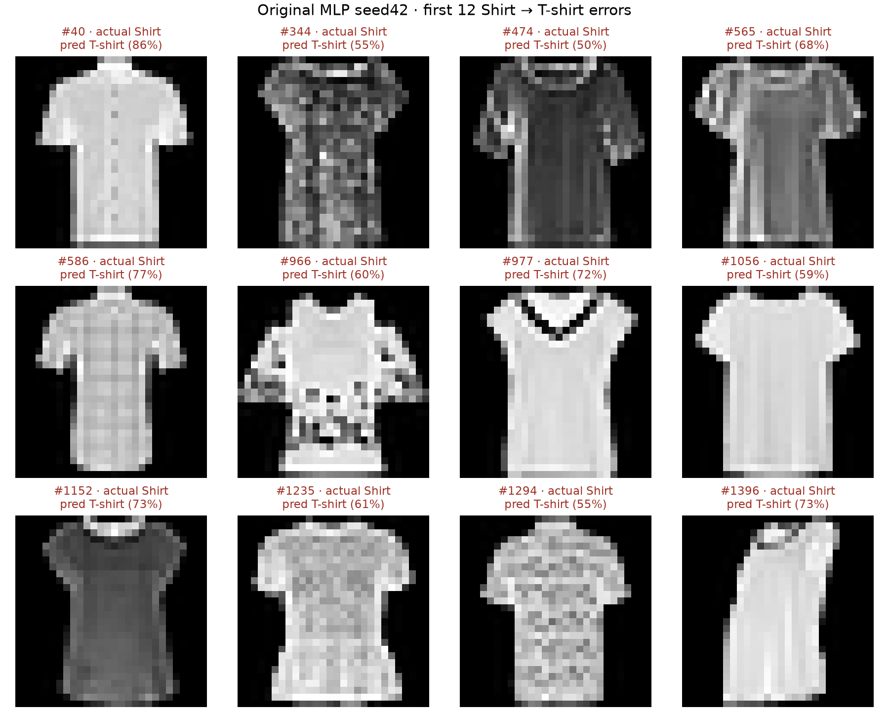

# ML Training and Inference Lab

A measured ML engineering project: paired neural-network training, inference optimization, reproducibility checks and a coding-agent repair pilot. Developed with coding-agent assistance; claims are linked to recorded experiments.

[](https://doi.org/10.5281/zenodo.24201648)

[Archived v1.0 — DOI 10.5281/zenodo.24201648](https://doi.org/10.5281/zenodo.24201648)

[What we found — العربية](FINDINGS.ar.md) · [Model card](MODEL_CARD.md) · [Data sheet](DATA_SHEET.md) · [Short project post](POST.md)

**Measurement correction:** the v1.0 Linux peak-RSS table is inconclusive and must not be used to compare runtimes. See [errata](ERRATA.md) and the completed [replacement Linux measurements](results/performance-linux/corrected/REPORT.md).

## V1.1: multi-file coding-agent trajectories

A fixed follow-up collected **72 independent task trajectories**: twelve synthetic ML engineering tasks × two models × three repetitions. Models selected real file/test actions through a bounded custom JSON tool interface; final correctness used **211 withheld cases** inside network-disabled Docker.

| Model | Accepted repairs (correct + submitted + protocol compliant) | Functionally correct final candidates |
| --- | ---: | ---: |
| GPT-6-Luna | 26/36 (72.2%) | 30/36 (83.3%) |
| GPT-6.1-Sol | 36/36 (100%) | 36/36 (100%) |

Luna's end-to-end failures comprise seven forbidden native resource-inventory calls, two step-budget exhaustions and one submitted schema/integration bug (`weight` versus `weights`). No protected-test write was observed. These results distinguish the models on this fixed suite; Sol's ceiling and the small purposive task sample limit generalization. The four actual maintenance-note exposures are not a broad injection-resistance evaluation. Visible tests all passed after edits, so a benefit from iterative repair after failed feedback is not demonstrated.

[Full report, uncertainty and limits](results/agents-v2/REPORT.md) · [Offline trajectory viewer](results/agents-v2/viewer.html) · [Failure example](results/agents-v2/failure_example.json) · [Frozen protocol](results/agents-v2/protocol.json)



## Training and inference results

| Model | Test accuracy, mean ± sample SD | Parameters | Batch-1 CPU latency, mean across seeds |
| --- | ---: | ---: | ---: |
| MLP | 88.428% ± 0.103 percentage points | 109,770 | 0.0438 ms |
| Small CNN | 88.968% ± 0.202 percentage points | 9,098 | 0.0834 ms |

Ten initialization/shuffle seeds per architecture, one fixed stratified split, ten epochs, identical optimization settings. CNN minus MLP accuracy: **+0.540 percentage points**, paired 95% seed-level t interval **[+0.435, +0.645]**, exact two-sided sign-flip **p = 0.001953**. This is conditional on the dataset split; it is not a population-data confidence interval or evidence of state-of-the-art performance.

Seed blocks share shuffle order through dedicated equal-seed generators; initialization and dropout differ between architectures. Pairing does not guarantee variance reduction. An unpaired Welch sensitivity check gives a 95% interval [0.386, 0.694] percentage points, p=3.54e-06; this sensitivity check ignores shared-order dependence.



[Six architectures on three common seeds: protocol, matched latency and results](results/capacity-sweep/REPORT.md). This post-hoc exploratory sweep reuses the official test set. The original ten-seed study remains separate.

The CNN has about twelve times fewer parameters but higher batch-1 latency on this CPU. The original two-model comparison alone does not establish a broad Pareto frontier. Marker area represents parameters; error bars are sample standard deviations.

- **Inference:** checked/unchecked ablations, fusion, compilation, dynamic int8 and ONNX Runtime. Prediction-changing variants are rejected by the strict parity policy. [Full runtime, profiler and peak-RSS report](results/performance/REPORT.md).
- **Reproducibility:** exact checkpoint resumption passes within Linux and within macOS; Linux tensors differ from the recorded macOS tensors. [Recorded evidence](results/reproducibility/).
- **Historical v1 zero-tool pilot:** GPT-6-Luna and GPT-6.1-Sol each passed 36/36 task attempts: twelve tasks × three repetitions. No crashes or timeouts. The suite shows a ceiling effect and establishes **no model ranking**. [Intervals, caveats and evidence](results/agents/REPORT.md).
- **Error analysis:** original seed42 Shirt recall is 72.7%; first Shirt→T-shirt errors are shown below. The ten-seed study also includes a separately identified representative seed0 analysis. These visual explanations are hypotheses, not demonstrated causes.



## Reproduce

Python 3.11+; the recorded local environment is Python 3.12.14, PyTorch 2.15.0, NumPy 2.5.4, macOS arm64, one CPU thread. No GPU or paid API key is needed for training and tests. The exact local package inventory is in `requirements-lock.txt`.

```bash
python3 -m venv .venv
source .venv/bin/activate
python -m pip install -e '.[dev,research,quality]'
ruff check .
ruff format --check .
python -m pytest -q

ml-lab download
ml-lab train --run runs/reproduce --epochs 10
ml-lab evaluate --run runs/reproduce
ml-lab benchmark --run runs/reproduce
ml-lab report --run runs/reproduce --out results/reproduced
```

The quick path trains an MLP. Add `--model-kind cnn` for the CNN. Open the generated `results/reproduced/report.html` for the quick-path report. Offline tests use synthetic fixtures; only dataset download and dependency installation need network access.

For the full fixed-split comparison:

```bash
python scripts/study.py
```

Completed results are reused only when their checkpoint SHA256 matches. Source archives do not include `runs/`; download and extract the separate checkpoint Release asset to reuse weights, or let the study train all twenty models. Existing interrupted full-data runs can be resumed by the study script.

For the advanced runtime experiment, train the canonical seed42 run in a fresh workspace first:

```bash
ml-lab train --epochs 10
python scripts/performance_study.py
python scripts/demo.py
```

The runtime script records failed/unsupported backends instead of inventing timings. Linux has its own completed hosted runtime experiment. The local macOS `torch.compile` attempt failed to load its C++ runtime. ONNX caches must match both checkpoint and graph SHA256 before reuse.

## Training and restoration

The MLP is Linear128 → BatchNorm → ReLU → Dropout0.2 → Linear64 → BatchNorm → ReLU → Dropout0.2 → Linear10. The CNN is Conv8 → ReLU → Pool → Conv16 → ReLU → Pool → Linear10. Both receive 784 flattened pixels; the CNN reshapes them internally.

Adam, learning rate 0.001, batch size 128 and mean cross entropy; finite-gradient checks and norm clipping at 5. Normalization is fitted only on training pixels. Minimum validation cross entropy selects checkpoints; the official test set is evaluated after selection. The original seed42 baseline scored 88.79%, separate from the ten-seed mean above.

Checkpoints preserve model/optimizer state, CPU RNG, an independent shuffle-generator state, completed epoch, normalization, split fingerprints and history. Writes are atomic. Resume rejects changed data/configuration and treats `--epochs` as the total target count:

```bash
ml-lab train --run runs/resume-demo --epochs 5
ml-lab train --run runs/resume-demo --epochs 10 --resume
```

A full original 10-epoch replay and shorter hosted full-dataset checks verify bitwise resumption. Cross-platform equality is measured, not promised.

## Benchmark protocol

CPU forward only, preloaded normalized validation inputs, fixed thread count, 20 warm-up forwards, seven randomly interleaved timing repetitions with `torch.utils.benchmark.Timer.blocked_autorange`. The architecture Pareto comparison uses three timing repetitions per seed. Raw timing blocks, setup costs and per-repeat variation are retained.

The advanced study compares the same model with input checks enabled and disabled. All outputs are checked against the same platform's selected eager checkpoint on 10,000 validation images. Runtime setup/compilation, data loading and preprocessing are excluded from forward latency. ONNX includes its NumPy/Torch bridge. These are not API-request latency or service capacity measurements.

Peak RSS is measured through OS high-water counters in separate fresh processes, including imports and model/runtime construction. It is not parameter storage or activation-only memory, and one observation per variant cannot establish a small memory reduction. Profiler operator counts/sections are instrumented diagnostics, not substitutes for the uninstrumented timing protocol or an isolated dispatch-cost measurement.

## Withheld coding-agent evaluation

[Contracts and broken starter](tasks/agent_suite/) are public. Two models generated three complete twelve-function repairs each, with identical instructions and budget, medium reasoning effort, no tools and no feedback. Immutable solutions, transcripts, prompt hashes and generation metadata are under `results/agents/`.

Candidates were graded on GitHub's Linux runner in Docker with no network, read-only filesystem/submission, unprivileged UID, no capabilities, no new privileges, CPU/RAM/PID limits and a timeout. The host grader and reference calculations are in a separate **private** repository and are not mounted into candidate containers. Twelve independent correct reference fixtures pass and twelve broken starters are rejected.

The observed rate is 100% for both models. The task-level all-repetitions Wilson reference interval is approximately 75.8%–100%; the nominal attempt-level interval is 90.4%–100%, but repeated tasks and shared suite responses violate independent-attempt assumptions. The selected pilot tasks are not a representative population sample. No reward hacking was observed; this is not an adversarial security certification. These are zero-tool code-repair trials, not multi-step tool-using agent trajectories.

The three original public local graders remain as development examples. Their `subprocess` runner is not the isolated withheld evaluator.

## CI and release artifacts

GitHub Actions runs correctness, Ruff and full-data exact-resumption checks on Linux and macOS. Actual completed evidence is linked in [results/reproducibility/ci.json](results/reproducibility/ci.json). The separate Linux runtime workflow records compiled/int8/ONNX experiments.

Source archives contain one canonical `results/` tree and no duplicated `runs/`, dataset or checkpoints. [Release v1.0](https://github.com/BasmallaMetwally/ml-training-inference-lab/releases/tag/v1.0) provides separate checkpoint and profiling/ONNX assets with SHA256 sums. Checkpoints retain resume state; run `scripts/package_release.py` after a committed checkout to rebuild local assets. The release assets are archived on [Zenodo](https://doi.org/10.5281/zenodo.24201648); CITATION.cff provides the issued version-specific DOI. Citation-only updates on the main branch do not change the archived v1.0 snapshot.

## Scope and sources

This is an educational CPU project on a small garment dataset. It does not demonstrate production deployment, GPU/distributed training, calibrated probabilities, broad agent rankings or professional employment experience. See [model card](MODEL_CARD.md), [data sheet](DATA_SHEET.md) and [Arabic walkthrough](GUIDE.ar.md).

- [Official Fashion-MNIST data, checksums and labels](https://github.com/zalandoresearch/fashion-mnist).
- [PyTorch reproducibility](https://docs.pytorch.org/docs/stable/notes/randomness.html), [checkpointing](https://docs.pytorch.org/tutorials/beginner/saving_loading_models.html), [benchmarking](https://docs.pytorch.org/tutorials/recipes/recipes/benchmark.html), [profiler](https://docs.pytorch.org/docs/main/profiler).
- [ONNX Runtime documentation](https://onnxruntime.ai/docs/).

Source license: MIT. Dataset attribution: [THIRD_PARTY.md](THIRD_PARTY.md).

Source provenance: `results/source_manifest.json` records the archived v1.0 sources; `results/followup_source_manifest.json` records the current correction and exploratory scripts. The Git history identifies both versions.
