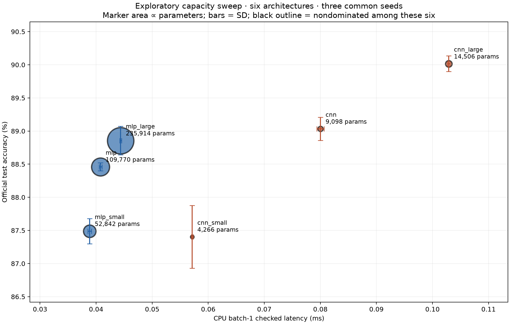

# Exploratory capacity sweep

Six architectures, common seeds 0–2, fixed split42, 10 epochs and identical optimization. MLP/CNN base checkpoints are reused from the original study. Four additional capacities were selected after v1.0 test inspection; official-test reuse makes this exploratory rather than a fresh confirmatory test.

| Model | Accuracy mean ± sample SD (%) | Parameters | Batch-1 latency mean ± SD (ms) | Nondominated |
| --- | ---: | ---: | ---: | --- |
| mlp_small | 87.490 ± 0.190 | 52,842 | 0.0388 ± 0.0003 | True |
| mlp | 88.460 ± 0.061 | 109,770 | 0.0408 ± 0.0003 | True |
| mlp_large | 88.857 ± 0.215 | 235,914 | 0.0444 ± 0.0002 | True |
| cnn_small | 87.403 ± 0.473 | 4,266 | 0.0571 ± 0.0002 | True |
| cnn | 89.033 ± 0.176 | 9,098 | 0.0800 ± 0.0007 | True |
| cnn_large | 90.017 ± 0.119 | 14,506 | 0.1029 ± 0.0002 | True |

Every latency above was remeasured after training with the same checked batch-1 zero input, one CPU thread, 20 warmups and five randomly interleaved repeats per checkpoint (blocked_autorange 0.1s). Plot bars are SD across three training seeds; these are not confidence regions for a Pareto frontier. Environment is the original macOS development machine. Small timing differences need repeat measurement on deployment hardware.

Nondominance is descriptive among these six measured means only, with three objectives: accuracy up, latency and parameter count down. Three seeds give limited precision; the ten-seed MLP/CNN inference remains the primary comparison.

[Plan](plan.json) · [Matched timing records and checkpoint hashes](latency-matched.json) · [Summary](summary.json). Individual result files retain their original training-time latency as provenance; only latency-matched.json supplies the table and plot.

Reproduce: `python scripts/capacity_sweep.py` from the project root after downloading the dataset and installing research dependencies.
