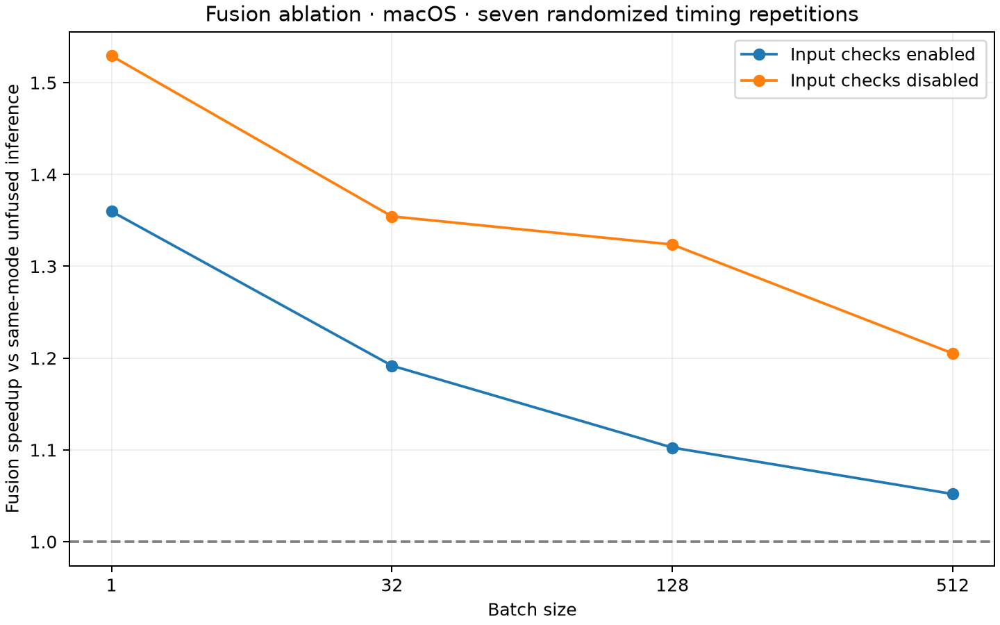
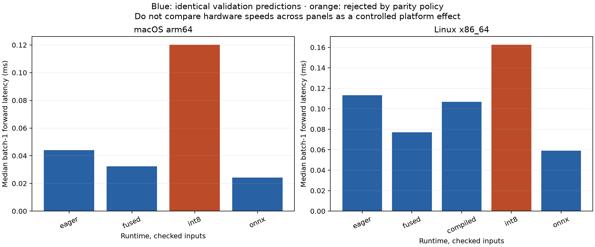

# Runtime and profiler study

All speedups compare the same selected checkpoint on the same platform. Zero validation prediction disagreements are required for accepted parity-preserving speed claims. Compilation and session construction are excluded from forward timing and recorded separately.

## macOS ablation

| Batch | Eager checked ms | Fused checked ms | Checked speedup | Unchecked speedup |
| --- | ---: | ---: | ---: | ---: |
| 1 | 0.0440 | 0.0323 | 1.36× | 1.53× |
| 32 | 0.0821 | 0.0689 | 1.19× | 1.35× |
| 128 | 0.1866 | 0.1692 | 1.10× | 1.32× |
| 512 | 0.5929 | 0.5636 | 1.05× | 1.21× |

Fusion helps with validation both enabled and disabled. The absolute input-check cost grows with batch size and can dominate the checked forward. This reduces the relative visible fusion gain; the speedup is not explained by silently removing input checks.

## Alternative runtimes

| Platform | Runtime | Batch-1 checked ms | Prediction changes / 10,000 | Exact-parity accepted |
| --- | --- | ---: | ---: | --- |
| macOS | eager | 0.0440 | 0 | True |
| macOS | fused | 0.0323 | 0 | True |
| macOS | compiled | unavailable | — | not accepted |
| macOS | int8 | 0.1201 | 32 | False |
| macOS | onnx | 0.0243 | 0 | True |
| Linux | eager | 0.1132 | 0 | True |
| Linux | fused | 0.0770 | 0 | True |
| Linux | compiled | 0.1067 | 0 | True |
| Linux | int8 | 0.1625 | 35 | False |
| Linux | onnx | 0.0592 | 0 | True |

Dynamic int8 is a measured negative result when it changes classifications, even if a particular platform makes it faster. ONNX is accepted only after checkpoint and graph fingerprints match. The full batch-size table, raw timing blocks and setup times are in each platform summary.

## Operator attribution

| macOS path | ATen calls / 100 forwards | Validation total µs | Network core total µs |
| --- | ---: | ---: | ---: |
| eager-checked | 9100 | 1847.9 | 6291.6 |
| eager-unchecked | 6800 | 0.0 | 6280.7 |
| fused-checked | 5900 | 1808.7 | 3924.4 |
| fused-unchecked | 3600 | 0.0 | 3810.0 |

Fusion removes the BatchNorm operator paths and reduces the number of ATen invocations. These instrumented totals include profiling overhead; operator self time does not independently identify pure Python or C++ dispatch overhead. Uninstrumented latency ablations supply the performance comparison. Do not subtract nested profiler totals as if they were independent costs.

## Actual peak process memory

| Platform | Runtime | Checks | Peak process RSS MiB | Baseline after imports MiB |
| --- | --- | --- | ---: | ---: |
| macOS | eager | True | 282.9 | 279.4 |
| macOS | eager | False | 282.5 | 279.7 |
| macOS | fused | True | 283.4 | 279.6 |
| macOS | fused | False | 282.9 | 279.4 |
| macOS | int8 | True | 284.8 | 279.5 |
| macOS | int8 | False | 285.0 | 280.1 |
| macOS | onnx | True | 306.2 | 280.0 |
| macOS | onnx | False | 305.7 | 279.8 |
| Linux | eager | True | 871.0 | 367.1 |
| Linux | eager | False | 871.0 | 367.0 |
| Linux | fused | True | 871.0 | 367.2 |
| Linux | fused | False | 871.0 | 367.0 |
| Linux | compiled | True | 871.0 | 367.2 |
| Linux | compiled | False | 871.0 | 367.1 |
| Linux | int8 | True | 871.0 | 367.1 |
| Linux | int8 | False | 871.0 | 367.0 |
| Linux | onnx | True | 871.0 | 367.0 |
| Linux | onnx | False | 871.0 | 367.0 |

Measured with OS high-water RSS in separate fresh processes, including imports, model/runtime construction and 50 batch-128 forwards. On Linux ru_maxrss KiB is converted to bytes; on macOS it is already bytes. These are process peaks, not peak activations or parameter storage. One process measurement per variant is not evidence of a small memory improvement. Compiled construction may reuse an on-disk compiler cache.

## Attempt audit

The macOS Inductor attempt failed while loading the C++ runtime and is recorded as unavailable; Linux compilation is separately measured. A first Linux ONNX attempt reused an exported graph from a different checkpoint and was invalidated. The cache now verifies both checkpoint SHA256 and graph SHA256 before reuse, with regression tests. Only the corrected run is included in the comparison.

Corrected Linux runtime run: https://github.com/BasmallaMetwally/ml-training-inference-lab/actions/runs/43453954524
